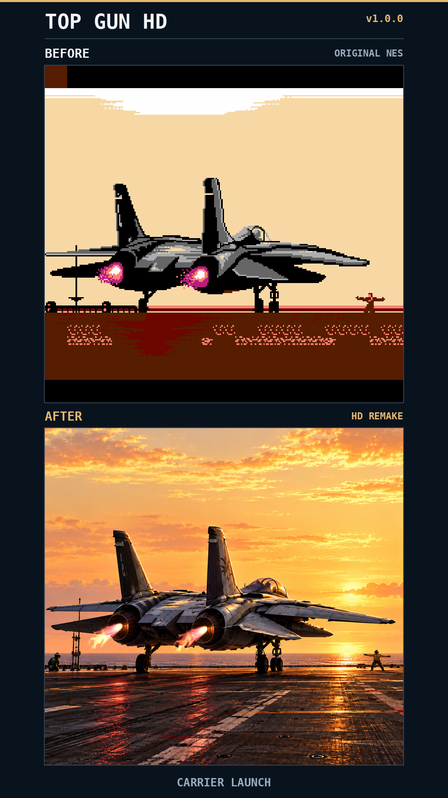
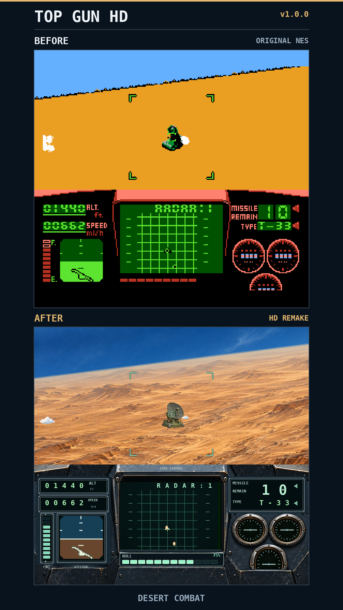
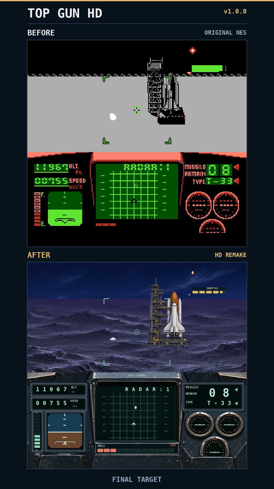
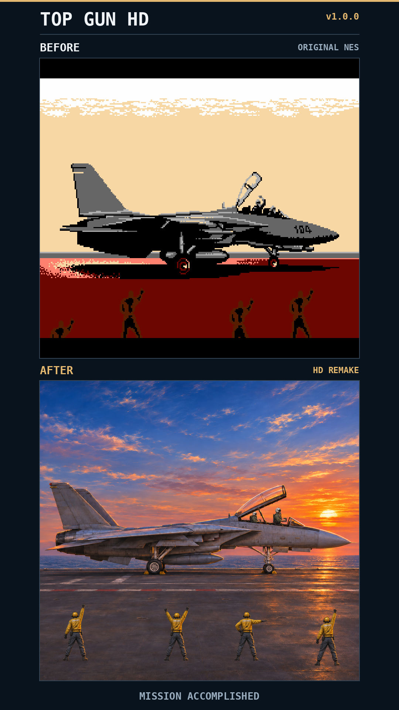

# Top Gun HD

**v1.0.0** — a 4× HD graphics pack for **Top Gun (USA)** on NES, for Mesen / MesenCE.

[Download v1.0.0](https://github.com/kgrant191/top-gun-hd/releases/tag/v1.0.0) · [Release notes](RELEASE_NOTES.md)

Painted carrier scenes, a detailed cockpit, day and night environments, updated enemies and targets, and new endings. The original game still controls movement, damage, collision, scores, animation timing and audio.

## Before and after

Actual synchronized emulator captures: original graphics above, HD pack below. Click an image to view it at full size.

| Carrier launch | Desert combat |
| --- | --- |
| [](docs/images/Top_Gun_HD_Before_After_01_Carrier_Launch.png) | [](docs/images/Top_Gun_HD_Before_After_02_Desert_Combat.png) |
| Final shuttle target | Mission accomplished |
| [](docs/images/Top_Gun_HD_Before_After_03_Final_Target.png) | [](docs/images/Top_Gun_HD_Before_After_04_Mission_Accomplished.png) |

All four 1080×1920 posting images are also available together in the release's images ZIP.

## Install

1. Download **Top_Gun_HD_v1.0.0.zip** from [Releases](https://github.com/kgrant191/top-gun-hd/releases). GitHub's automatic source ZIP is for development.
2. Extract all 273 files into the HD pack folder associated with your own **Top Gun (USA)** ROM. The folder name must match the ROM filename without its extension. For example, `Top_Gun_HD.nes` uses `HdPacks/Top_Gun_HD/hires.txt`.
3. Keep `hires.txt` and all PNGs together, without another nested folder. Enable HD packs in the emulator and reopen the ROM. When upgrading, replace the old files with this complete pack.

No ROM or emulator is included. The source tree, validation captures and promotion files are not needed to play.

## Included

- Title, briefing, loadout and animated carrier launch.
- Cockpit instruments, live HULL indicator and amber danger display.
- Painted ocean, cloud deck, desert and night environments across four missions.
- Aircraft, helicopters, naval and ground targets, missiles and explosions.
- Carrier approaches, touchdown, rollout and aerial refueling.
- Final shuttle target, awards and sunset carrier celebration.
- Correct **10000 PTS** bonus, consistent adult deck crew and a steady pilot wave.

## Validation and coverage

The release preserves all 271 approved v0.15.1 PNGs and every graphics mapping rule. Recorded replays compare native RAM, graphics state and PCM audio with the HD pack enabled. Promotion captures use matched game-state and CHR traces.

Testing covers the supplied recordings across all four missions. Unrecorded outcomes are not certified: Mission 3 boss defeat/landing and the continuous shuttle-defeat-to-success transition remain absent from the recordings. See [validation reports](validation/) and [development history](docs/DEVELOPMENT_HISTORY.md) for the exact scope.

## Build from source

Use Python 3.12, then run:

```sh
python -m pip install -r requirements.txt
python scripts/build_pack.py
python scripts/verify_release.py
python scripts/package_release.py
```

Generated installation files go in `pack/`; release ZIPs go in `output/release/`. Source art and necessary tile captures are included. Emulator replay tests require your own ROM and emulator. Selected input recordings are in `reference/`; the large rendered QA captures are not distributed.

The promotion composition script is `scripts/build_promo.py`. Its capture-manifest format and scene selections are documented in [docs/PROMOTION.md](docs/PROMOTION.md).

An unofficial fan project. Top Gun and the original game belong to their respective rights holders.
