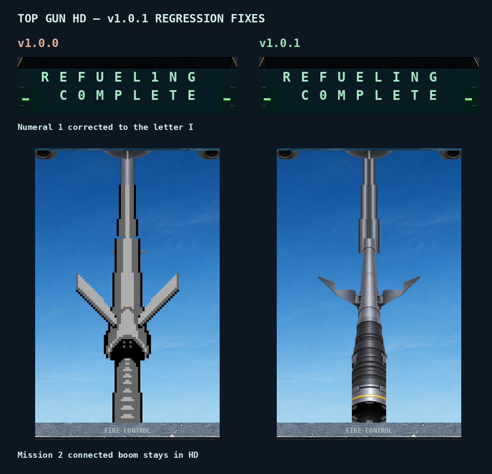

# v1.0.1 regression review

The refueling completion message displayed **REFUEL1NG COMPLETE**: the shared native I/1 tile selected the numeral artwork. A cell- and state-specific override now renders **REFUELING COMPLETE** in Missions 2, 3 and 4 without changing numeric counters.

Mission 2 also omitted the connected-boom mapping already implemented for Missions 3 and 4. That pose now uses the existing approved HD art.

## Verification

| Check | Result |
| --- | --- |
| Distinct supplied recordings replayed | 34 |
| Recorded inputs | 122,329 |
| Matched HD checkpoint pairs | 1,003 |
| Pixel-identical checkpoints | 995 |
| Intended changed checkpoints | 8: six text, two connected-boom |
| Broad checkpoint RAM pairs available | 996, all identical |
| Continuous refueling replay | 1,380 inputs; native/HD RAM identical every frame |
| Candidate HD loader warnings | 0 |
| Artwork preservation | All 271 PNGs unchanged |
| Source rebuild | All 273 install files byte-identical to tested candidate |

The condition-order fix moves 305 definitions before their first reference. Graphics-rule priority and later condition redefinitions are retained. No visual changes outside the intended refueling corrections remain in the checkpoint comparison. One asynchronous screenshot discrepancy was resolved by isolated recapture.

136 representative checkpoints and all changed checkpoints were visually reviewed; the remaining checkpoint images were compared automatically. Broad visual testing is sampled, not a claim that every video frame was inspected. Seven checkpoint RAM pairs were unavailable after interrupted capture jobs; their screenshot pairs were recovered and compared. Full-suite audio was not compared again. No ROM, gameplay or audio patches are included.

Unrecorded outcomes remain outside coverage, including Mission 3 boss defeat/landing and continuous shuttle defeat-to-success. Prepared as a review candidate; publication follows user review.
